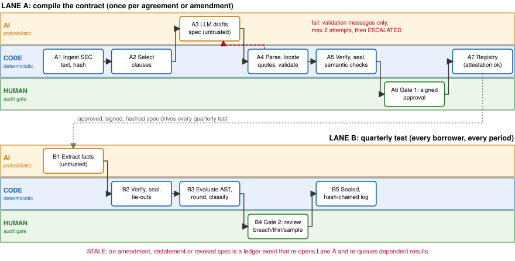

# Auditable Covenant Compliance: let the LLM read the contract once, let code compute it every quarter

**Domain:** commercial-loan financial-covenant monitoring. **Jurisdiction:** US credit agreements (NY law). **Data:** a real public agreement from SEC EDGAR, Viad Corp's Credit Agreement of 30 Jul 2021 (accession 0001564590-21-039835) and its First Amendment of 23 Mar 2022 (0000950170-22-004478). **Borrower financials are synthetic. Cost figures are my estimates, not sourced data.** For another jurisdiction the definitions and amendment conventions change; the architecture does not.

**What surprised me.** The ratio math is trivial (net debt / EBITDA); the risk is the *definition*. Reading the real agreement made that concrete: (1) "Consolidated EBITDA" allows run-rate cost savings only up to **20.0%** of EBITDA calculated before that add-back; (2) "Unrestricted Cash" may be netted in full, **unless** revolver borrowings exceed $10,000,000, when it is capped at $50,000,000, a conditional that a flat formula cannot express; (3) Section 1.04 prescribes a rounding rule (carry the ratio one place beyond its stated precision, round to nearest, ties up) that decides whether 4.505x breaches 4.50x; (4) a First Amendment, one year later, **restated the covenant levels** (5.25x stepping down to 4.00x). The base agreement alone gives the wrong answer for every date after March 2022, so a missing amendment is a real failure mode, not a hypothetical one.

## 1. Problem statement

| | |
|---|---|
| **Who** | Covenant-monitoring analysts in credit administration at a mid-market lender; the credit officer who signs findings. |
| **Task** | Each quarter, per borrower: find the financial covenants in a 100-300 page agreement, apply every amendment, take inputs from the financials, recompute the ratios under the contract's own definitions, flag breaches and thin headroom. |
| **Frequency** | Quarterly. About 400 borrowers gives about 1,600 tests a year; certificates are due about 45 days after quarter end, so about 60% land in one 3-week window. |
| **Cost today** | About 4.5 h per test, about 7,200 h a year, roughly 4 FTE, about $650K a year at $90/h loaded. The larger cost is a breach found late or a false pass. |
| **Out of scope** | Waiver and legal-notice decisions, pricing and rating, non-financial covenants, equity-cure and Acquisition-Period alternatives (recorded in each spec as "not modelled"), pro-forma adjustments, any real client data. Decision support, not legal advice. |

## 2. Solution design

**Core idea.** The LLM interprets the contract **once per agreement version** into a typed `CovenantSpec` built from nine AST node types. Code verifies every quotation, a human signs the approval, and a deterministic engine computes every quarter. **Why AI at all:** definitions are bespoke prose with cross-references; reading them is the one step regex and templates cannot do. Where a register or form already gives structured data, no AI is needed.

| Stage | Actor | What happens |
|---|---|---|
| A1-A2 | Code | Download from SEC, split at page breaks, canonicalise, SHA-256 the text. Select the covenant pages and follow the defined terms the ratio uses, to a bounded depth; list the terms **not** read. |
| A3 | **AI** | Drafts the spec as JSON. Each constant, input and threshold carries `{document, page, quote}`. Offsets and hashes are never taken from the model. It has no tools. |
| A4 | Code | Reject the whole answer if it contains forbidden fields (`verified`, `approval`, `status`, `seal`, code or tool calls). Locate each quote in the stored text (must be exact and unique). Run the spec validators (no unsourced literal, cycle, unresolved term, threshold gap). |
| A5 | Code | Independently re-verify every quotation, seal the spec, run semantic checks (a threshold or constant must appear in its own quote, comparison direction, unused or invented inputs). Render the formula from the AST for the reviewer. |
| A6 | **Human** | Types the first 12 hash characters of the spec shown. A signer issues an attestation over spec hash, approver, role, decision and time. Unresolved items, failed checks and unread amendments **block** approval. |
| A7 | Code | Registry re-verifies seal and attestation; versions are effective-dated and never overwritten. |
| B1-B5 | AI, code, human | Facts are extracted and sealed (quote, printed amount and scale, grounded tie-outs). The `Decimal` evaluator traces every node, applies the contract's rounding, classifies, and appends a hash-chained record. BREACH, INDETERMINATE, thin headroom and a 10% sample go to a human. |

**Knowledge management.** Contract meaning lives in the approved, signed, versioned spec (code, not model weights); evidence lives in hash-pinned documents; bank policy (thin-headroom %, sampling, OCR floor) lives in a policy object whose hash is stored in every result. **When knowledge becomes invalid:** an amendment is a new spec version that applies only from its effective date (retroactive only if it cites a clause that says so); a restatement marks results built on the old facts stale; a revoked spec blocks the periods it governed until a corrected one is approved, and never falls back to the older version. All are ledger events; nothing is edited.

**Audit lineage.** `status -> ratio -> trace step -> fact -> statement line`, and `constant -> quotation -> (document hash, page, offsets)`. The pinned engine version re-runs sealed inputs to the same result (`replay_result`).

## 3. What is built, and the evidence

**Built and tested (246 tests, offline; mypy clean).** Typed models (`Decimal` only, frozen, tuples); AST evaluator with a per-node trace and the conditional node the real cash cap needed; trusted verification and seals; signed approval attestations; effective-dated registry; hash-chained ledger; SEC ingestion with hash-pinned pages; deterministic clause selection; strict extraction parser; reviewer view and CLI; an OpenRouter provider (timeouts, 429 retry, truncation checks, no tools offered). A script (`tools/mutation_check.py`) breaks 28 guarantees one at a time to check the tests notice; all were caught.

**On the real agreement.** The approved spec (7 defined terms, 20 inputs, cited page and offsets) gives, for a synthetic borrower on 31 Dec 2022: EBITDA before clause (d) 184.0; add-back cap 20.0% x 184.0 = 36.8 (not the 40 claimed); netted cash MIN(120, 50) = 50 because revolver borrowings of 25 exceed 10; net funded debt 805; ratio 805 / 220.8 = **3.646x** against the amended **4.75x**: PASS, 23.2% headroom. The same inputs on 30 Jun 2023 face 4.00x and are PASS with thin headroom, which goes to review.

**Not done, stated plainly.** (1) **No live model run**: no API key was available, so no genuine LLM extraction exists. The provider is tested against a fake transport only. (2) The extraction used in the demo is a **reference I had the coding assistant hand-write** from the real text; it is labelled "NOT A LIVE MODEL CALL". (3) The scorecard that checks an extraction against the contract's key facts was written by the same assistant, so a perfect reference score is circular; its tests show it fails on wrong extractions. (4) The demo approval is simulated. (5) Designed but not built: compliance-certificate back-test, two independent extractions diffed, hidden-text detection, amendment register, KMS signing and multi-signer approval, persistent ledger, OCR.

## 4. Risks

**Weakest link: a wrong but well-sourced spec at the approval gate.** A quotation can be real and the reading wrong (the wrong cap, the pre-amendment definition, numerator and denominator swapped). A test in the repository shows it: a swapped ratio passes every machine check, and only the readable formula exposes it. Because the spec drives every test for years, an error repeats. **Built:** semantic checks (e.g. 0.25 cited to a quote that says "20.0%" is refused), the AST-generated plain formula, signed approval bound to the displayed hash, a clean-pass sample, the scorecard. **Designed only:** back-test against the borrower's historical certificates, two extractions diffed.

| Input condition | Failure mode | Response (built unless marked *designed*) |
|---|---|---|
| **Noisy** | Look-alike characters, "20 .0%" artefacts, scanned pages, scale errors | Canonicalised text; exact unique quotes; OCR pages refused; printed amount and scale checked; tie-outs must sum. OCR ingestion *designed*. |
| **Incomplete** | Amendment not provided; terms referenced but not read; missing input | Known amendments listed, approval blocked if unread; unread terms reported; missing input is INDETERMINATE; no spec governs undated periods. Amendment register *designed*. |
| **Adversarial** | Prompt injection in a document; invented or paraphrased quote; model supplying `verified` or an approval | Text is data; response schema has no tool field and forbidden keys reject the whole answer; quote must exist exactly; extractor and automated identities cannot approve; seals and attestations re-verified. Hidden-text detection *designed*. |

| Risk | Handling |
|---|---|
| **Wrong answer** | Typed AST, `Decimal`, one `classify()`, results re-derived on construction; INDETERMINATE by default; two human gates; replay. |
| **Outdated rules** | Versioned, effective-dated specs; amendment, restatement and revocation are different ledger events. |
| **Confidential data** | The prototype uses public filings and synthetic data. Real borrower material needs a model inside the lender's boundary (a hosted free-tier model is not acceptable for it). |
| **Liability** | The credit officer is accountable for each approval and finding; the system sends no notices. The development signer proves a record was not altered; it does **not** authenticate the approver. Production needs KMS signing and SSO identity. |

## 5. Alternatives considered and rejected

1. **One long-context LLM call returns the ratio.** Rejected: arithmetic is non-reproducible, silent errors have no tie-out, lineage is a story rather than a trace.
2. **Per-quarter RAG "chat with the contract".** Rejected: definitions are re-read each quarter, so Q1 and Q3 can differ; no versioned knowledge and no proof of which clause applied.
3. **Rules and templates only.** Rejected: exact but brittle; the real agreement's conditional cash cap, sub-capped add-backs and rounding clause break any fixed template. Kept for the engine, dropped for ingestion.

Also rejected: routing by LLM self-reported confidence (uncalibrated) and LLM-written Python for the maths (unreviewable; the closed AST is).

## 6. Before spending more time on this

Run live extractions with a real model on at least 10 agreements and publish the failures using the scorecard. Validate the 4.5 h per test and the amendment-completeness assumption with practitioners. Build the certificate back-test, since it is the only control that checks the *meaning* of a spec. Confirm data-residency terms and the loan system the results must feed.

## Appendix: What you added beyond the AI

**Where AI helped.** Claude (Cursor cloud agent) wrote nearly all the code, tests and documents. Key prompts (excerpts): (1) *"Act as a Principal Agentic AI Architect... enforce strict separation between probabilistic nodes (LLM extraction, RAG) and deterministic execution engines (Pydantic, ratio math, rules)..."* (2) *"Do not assume that the existing implementation is correct merely because tests pass... The LLM must never perform financial calculations that determine the final covenant result."* (3) *"The LLM should interpret the contract, but the deterministic engine must remain the sole authority for financial calculations and covenant classification."*

**What was wrong, and how it was caught.**

- *Verification that trusted flags.* The AI's first draft let a caller set `verified=True` or a tie-out `passed=True`, and hardcoded a 10% headroom rule. A review prompt I wrote made the AI reproduce six defects by running code; they became sealed artefacts, derived tie-outs and a policy object.
- *A gap the AI found in its own fix.* While writing the prompt-injection test the AI saw that tie-out components were still the extractor's word, and made each one a quoted, summed source line.
- *Four bugs the tests exposed:* a canonicaliser that mis-paired nested quotes, a clause search that ran out of budget before the cash definition, a false-positive "constant denominator" check, and an old test whose blanket import ban the new download code correctly broke. The AI narrowed that assertion, with a documented reason, instead of deleting it.
- *Unsourced numbers.* The cost figures are the AI's estimates; I labelled them as such.
- *Rejected designs:* LLM self-reported confidence as a routing signal (uncalibrated) and LLM-generated Python for the maths (unreviewable).
- *Honesty limits I required:* no simulated model call may pass as live; the reference extraction and its scorecard are labelled as written by the AI.

**What came from me.** I chose covenant monitoring over rebate reconciliation. I set the rule that the LLM never touches a number in the ratio path, required the four audit questions (knowledge, lineage, weakest link, rejected alternatives) to drive the structure, and demanded a real public agreement and no pretending that a replay was a model. I required the development signer to be kept apart from a production one and not to be called identity authentication. I expected secondary sub-caps inside EBITDA add-backs to force dynamic sub-trees; the real filing confirmed it (a 20.0% cap, a conditional cash cap, a rounding clause). I chose to stay with this project after weighing alternatives.

**One concept I can defend live without AI: what "deterministic" guarantees and what it does not.** Synthetic borrower: debt 540, cash 40, EBITDA 100, add-backs 40, add-backs capped at 25% of 100. Capped EBITDA = 100 + MIN(40, 25) = 125; net debt = 540 - 40 = 500; ratio 500 / 125 = **4.00x** against 4.50x, headroom 11.1%, PASS. Without the cap it would be 3.57x, an overstated pass. Rounding precedes the comparison, so 4.504 is 4.50 and passes while 4.505 is 4.51 and breaches (half-up). `Decimal` is used because binary floats cannot hold these values exactly. The limit: quotation checks prove a quote exists and the spec is consistent, not that it *means* what the contract means. That gap is why the human gate exists.
